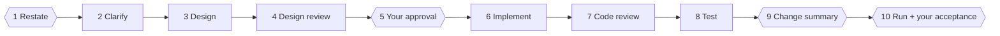

# dev-crew SKILL

[简体中文](./README.md) | **English**

Background and the thinking behind this skill (in Chinese): [Why AI made programming more tiring, and what I did about it](./为什么AI让编程更累了？我的思考和解决办法.md)

**What is dev-crew?**

The dev-crew skill completes a task with one virtual manager and several virtual programmers working together. It greatly reduces your mental load and raises the quality of the work.

## Install

Pick one; installing it two ways gives you the skill twice.

**Claude Code plugin:**

```
/plugin marketplace add yaodongen/dev-crew
/plugin install dev-crew@dev-crew
```

**Claude Code and other agents, via the [skills CLI](https://github.com/vercel-labs/skills):**

```bash
npx skills add yaodongen/dev-crew --global --agent claude-code   # Claude Code
npx skills add yaodongen/dev-crew --global --agent codex         # Codex
npx skills add yaodongen/dev-crew --global --agent '*'           # every agent it detects
```

Leave off `--global` to install only in the current project.

**Manually (Claude Code):**

```bash
git clone https://github.com/yaodongen/dev-crew ~/.claude/skills/dev-crew
```

## What it does

**Restate → Clarify → Design → Design review → Your approval → Implement → Code review → Test → Change summary → Run it for your acceptance**

The thinking you have to do is packed into the first five steps. Major questions are asked before any code changes; minor ones are decided for you, written down, and shown to you together at the end. After you approve the design, you are rarely interrupted again until acceptance.

It is a plain [Agent Skill](https://agentskills.io): a `SKILL.md` and two reference files, no code and no dependencies.

## Why

Coding agents fail on larger tasks in predictable ways. dev-crew is built around five of them:

| Problem | What dev-crew does |
|---|---|
| Agents stop mid-task to ask questions; with several tasks running, you are interrupted and switching context all day | Major questions are asked once, before any code changes. Minor ones (easy to change later) are decided by the crew, logged in `decisions.md`, and confirmed with you at approval and acceptance |
| One agent misses things in its own work | Design and code are each reviewed by a fresh subagent that never saw the author's reasoning |
| Agents skip steps ("looks fine, moving on") | The manager writes no code and only runs the process; each step has a gate that must be met and logged before the next begins |
| Agents make changes nobody asked for | After implementation, the manager checks the real `git diff` against the approved design and lists every out-of-scope change for you to keep or revert |
| "Done" and "tests pass" are just claims | Tests need real command output on file, and the manager reruns the key commands itself |

## Use

Tell your agent, in any language:

```
Use dev-crew for this task: add CSV export to the orders page
```

```
用 dev-crew 做这个需求：订单页增加导出 CSV
```

Resume an interrupted task:

```
Continue the dev-crew task export-csv
```

The manager replies in your language and writes the process files in it too.

dev-crew is for features, refactors, and non-trivial bug fixes that deserve a design and a review. For a one-line change, just ask the agent directly.

## The workflow



| # | Step | Who | Gate to pass |
|---|---|---|---|
| 1 | Restate the request | The manager restates the request to **you** in its own words and settles where the code will be changed; while you reply, programmer A is already reading the code in the background | You confirm it understood correctly |
| 2 | Clarify requirements | Programmer A checks the request against the code; major questions go to **you** in one batch, minor ones are decided for you and logged | Every major question answered; verifiable acceptance criteria |
| 3 | Design | Programmer A writes a high-level design, a page or two, no implementation detail | `design.md` is complete |
| 4 | Design review | Fresh programmer B looks only for wrong-direction problems, usually 1 round, at most 2; the manager rules on each comment | No unresolved blocking comment |
| 5 | Approval | The manager presents the design to **you**: an architecture diagram when several modules are involved, the decisions made for you, and what you need to decide | You explicitly approve. No code is touched before this |
| 6 | Implement | Programmer A implements the design, deciding and logging the details; several programmers in parallel when the work can be split | Implementation reported complete |
| 7 | Code review | Fresh programmer B reviews the diff against the design, up to 3 rounds | No unresolved blocking comment |
| 8 | Test | Programmer A tests; the manager reruns key commands | Every acceptance criterion backed by real output |
| 9 | Change summary | The manager reads the real diff and writes up out-of-scope changes and the decisions made for you | The summary is sent to you |
| 10 | Run and accept | The manager starts the app locally, or deploys it to a remote dev environment after **you** confirm; **you** check it yourself against the acceptance checklist and confirm the step 9 items at the same time | You confirm acceptance |

The gates are mandatory. If a later step finds a problem, the workflow goes back to the right earlier step and the steps after it are done again.

Steps 1–5 are kept fast because you are waiting: short documents, only direction-level issues. Steps 6–9 are there for quality and take longer, but you do not have to watch them.

### Where the code is changed

The manager proposes a branch name that follows your project's existing naming convention and covers this in the same message as the restatement:

- If the current directory has uncommitted changes, it creates a separate git worktree for the task and tells you the name and location, so your changes and the task's changes never mix.
- If the directory is clean, it asks: a worktree, a new branch in place, or the current branch.

### Major and minor questions

- **Minor**: easy to change afterwards if the choice was wrong, such as 3 retries or 5. You are not asked. The crew picks an answer and logs the question, the decision, the reason, and how to change it back in `decisions.md`.
- **Major**: costly to reverse or wide in impact, such as whether to change the design of a core module. Only these are brought to you, and as far as possible before step 5.

The decisions made for you are shown at step 5 and again at acceptance. They stand by default; you speak up only if you disagree.

### Parallel work

When a task spans several repositories, or several modules in one repository whose files do not overlap, the design is still written and approved once, with an explicit contract between the parts. Implementation then runs in parallel with one programmer per part, and the changes are reviewed by a separate fresh reviewer. Testing verifies everything together.

### What it leaves behind

Process files are kept under `.dev-crew/<task>/` in your repository: requirements, design, the decisions made for you, each review round with the manager's rulings, the test report, the change summary, and a `status.md` gate log. An interrupted session resumes from that log.

dev-crew never commits, merges, or cleans up on its own. Those are yours to decide.

## How it is built

```
dev-crew/
├── SKILL.md                 the manager's playbook
└── references/
    ├── briefs.md            task briefs the manager gives to programmer subagents
    └── templates.md         templates for process files and reports
```

The design rests on four ideas, one about people and three about language models:

- **Your attention is the scarcest resource.** Every interruption costs a context switch, and too many of them make decisions worse. So questions are sorted by weight: major ones first, minor ones later.
- **Independent judgment needs independent context.** A reviewer that has seen the author's reasoning tends to confirm it. Reviewers here get only the result.
- **The manager stays out of the work so the process survives.** A session full of implementation detail loses track of process rules. The manager's context stays small.
- **Files are the single source of truth.** Every conclusion is written down, so programmers can be swapped for fresh subagents at any step and nothing depends on one long conversation.

## Requirements and limits

- A git repository. The change summary depends on diffs.
- An agent with subagent support. Without it, the skill tells you and falls back to a single agent, which loses the independent review.
- It uses more tokens and time than asking an agent to "just do it". That is the trade for fewer interruptions, the reviews, and the audit.

Finally, I hope you enjoy this skill, enjoy thinking, and enjoy staying in flow. Thank you.

## License

[MIT](./LICENSE)
