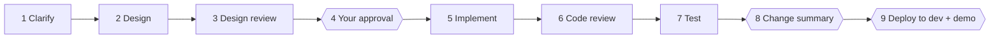

# dev-crew

**English** | [简体中文](./README.zh-CN.md)

dev-crew turns one coding-agent session into a manager that runs a real development task through a gated workflow, delegating the work to programmer subagents and the reviews to separate, fresh ones.

**Clarify → Design → Design review → Your approval → Implement → Code review → Test → Change summary → Deploy to dev**

It is a plain [Agent Skill](https://agentskills.io): a `SKILL.md` and two reference files, no code and no dependencies.

> Status: early version. Built for Claude Code; it should work in any agent that supports skills and subagents.

## Why

Coding agents fail on larger tasks in predictable ways. dev-crew is built around four of them:

| Problem | What dev-crew does |
|---|---|
| One agent misses things in its own work | Design and code are each reviewed by a fresh subagent that never saw the author's reasoning |
| Agents skip steps ("looks fine, moving on") | The manager writes no code and only runs the process; each step has a gate that must be met and logged before the next begins |
| Agents make changes nobody asked for | After implementation, the manager checks the real `git diff` against the approved design and lists every out-of-scope change for you to keep or revert |
| "Done" and "tests pass" are just claims | Tests need real command output on file, and the manager reruns the key commands itself |

## Install

Pick one; installing it two ways gives you the skill twice.

**Claude Code plugin:**

```
/plugin marketplace add yaodongen/dev-crew
/plugin install dev-crew@dev-crew
```

**Claude Code and other agents, via the [skills CLI](https://github.com/vercel-labs/skills):**

```bash
npx skills add yaodongen/dev-crew --global --agent claude-code   # Claude Code
npx skills add yaodongen/dev-crew --global --agent codex         # Codex
npx skills add yaodongen/dev-crew --global --agent '*'           # every agent it detects
```

Leave off `--global` to install only in the current project.

**Manually (Claude Code):**

```bash
git clone https://github.com/yaodongen/dev-crew ~/.claude/skills/dev-crew
```

## Use

Tell your agent, in any language:

```
Use dev-crew for this task: add CSV export to the orders page
```

```
用 dev-crew 做这个需求：订单页增加导出 CSV
```

Resume an interrupted task:

```
Continue the dev-crew task export-csv
```

The manager replies in your language and writes the process files in it too.

dev-crew is for features, refactors, and non-trivial bug fixes that deserve a design and a review. For a one-line change, just ask the agent directly.

## The workflow



| # | Step | Who | Gate to pass |
|---|---|---|---|
| 1 | Clarify requirements | Programmer A asks; the manager answers only with a source, otherwise asks **you** | No open questions; verifiable acceptance criteria |
| 2 | Design | Programmer A | `design.md` is complete |
| 3 | Design review | Fresh programmer B, up to 3 rounds; the manager rules on each comment | No unresolved blocking comment |
| 4 | Approval | The manager presents the design to **you** | You explicitly approve. No code is touched before this |
| 5 | Implement | Programmer A, strictly to the design | Implementation reported complete |
| 6 | Code review | Fresh programmer B reviews the diff against the design, up to 3 rounds | No unresolved blocking comment |
| 7 | Test | Programmer A tests; the manager reruns key commands | Every acceptance criterion backed by real output |
| 8 | Change summary | The manager reads the real diff and reports to **you** | Every out-of-scope change has your decision |
| 9 | Deploy and demo | The manager deploys to dev after **you** confirm, then demos each criterion | You confirm the demo passed |

The gates are mandatory. If a later step finds a problem, the workflow goes back to the right earlier step and the steps after it are done again.

### Where the code is changed

Before starting, the manager proposes a branch name that follows your project's existing naming convention, then:

- If the current directory has uncommitted changes, it creates a separate git worktree for the task and tells you the name and location, so your changes and the task's changes never mix.
- If the directory is clean, it asks once: a worktree, a new branch in place, or the current branch.

### Tasks across several repositories

The design is still written and approved once, with an explicit contract between the repositories. Implementation then runs in parallel with one programmer per repository, and each repository's changes are reviewed by a separate fresh reviewer. Testing verifies everything together.

### What it leaves behind

Process files are kept under `.dev-crew/<task>/` in your repository: requirements, design, each review round with the manager's rulings, the test report, the change summary, and a `status.md` gate log. An interrupted session resumes from that log.

dev-crew never commits, merges, or cleans up on its own. Those are yours to decide.

## How it is built

```
dev-crew/
├── SKILL.md                 the manager's playbook
└── references/
    ├── briefs.md            task briefs the manager gives to programmer subagents
    └── templates.md         templates for process files and reports
```

The design rests on three ideas about how language models behave:

- **Independent judgment needs independent context.** A reviewer that has seen the author's reasoning tends to confirm it. Reviewers here get only the result.
- **The manager stays out of the work so the process survives.** A session full of implementation detail loses track of process rules. The manager's context stays small.
- **Files are the single source of truth.** Every conclusion is written down, so programmers can be swapped for fresh subagents at any step and nothing depends on one long conversation.

## Requirements and limits

- A git repository. The change summary depends on diffs.
- An agent with subagent support. Without it, the skill tells you and falls back to a single agent, which loses the independent review.
- It uses more tokens and time than asking an agent to "just do it". That is the trade for the reviews and the audit.

## License

[MIT](./LICENSE)
