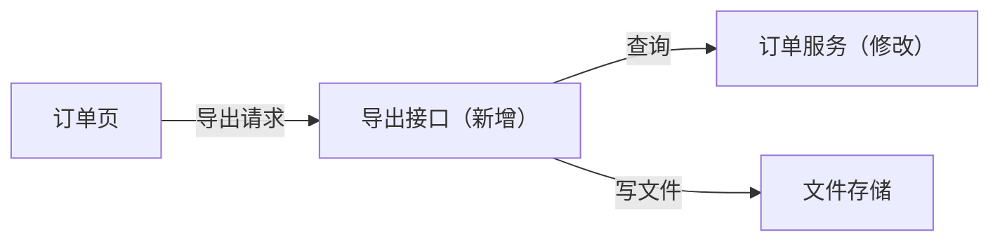

# 文件模板

`design.md` 和 `test-report.md` 由程序员写，格式在 `briefs.md` 的第 3 步和第 8 步里。

模板是中文的。用户使用其他语言时，实际的文件用用户的语言写，包括标题。

## status.md

```markdown
# <需求简称>

- 当前步骤：第 <N> 步 <步骤名>（全部完成后写"已完成"）
- 工作区：<绝对路径>（worktree / 当前仓库目录；确定之前写"待定"）
- 分支：<分支名>（新建，基于 <基准分支> / 沿用当前分支）
- 基线 commit：<确定工作区时工作区里的 HEAD>

（需求涉及多个仓库时，把上面三行换成一张表：
| 仓库 | 工作区 | 分支 | 基线 commit |）

## 关卡记录
只追加，不修改已有的行。状态取值：通过 / 用户要求跳过 / 回退。

| 时间 | 步骤 | 状态 | 备注 |
|---|---|---|---|
| 2026-01-01 09:50 | 1 需求复述 | 通过 | 用户更正了 1 处后确认；工作区已建 |
| 2026-01-01 10:00 | 2 需求澄清 | 通过 | 问了用户 1 个大问题，代为决定 3 个小问题 |
| 2026-01-01 10:40 | 3 方案设计 | 通过 | |
| 2026-01-01 11:30 | 4 方案 review | 通过 | 共 1 轮，采纳 2 条 |
| 2026-01-01 14:00 | 5 用户审批 | 通过 | 用户原话："可以，按这个做" |
| 2026-01-01 15:10 | 6 实现 | 通过 | 改动文件：a.ts、b.ts |
| 2026-01-01 16:00 | 8 测试 | 回退 | 第 2 条验收标准失败，回到修复和代码 review |

## 待用户决定
- <当前在等用户回答的事项，没有则写"无">

## 留到用户验收时验证的验收标准
- <本地无法验证、留到第 10 步的条目，没有则写"无">
```

## requirements.md

你建文件时只写"原始需求"。第 1 步发出复述时写"需求复述"并标注"待用户确认"，用户确认后去掉标注。其余三节由程序员 A 填写；"回答""出处""用户确认"三列由你填。每一行都要经用户确认后才能进入第 3 步。问答记录里只放大问题，小问题记在 `decisions.md`。

```markdown
# 需求

## 原始需求
<用户的原话，不改写>

## 需求复述
<你用自己的话写的复述，经用户确认：要做什么、做完后的效果、范围边界>

## 需求理解

## 验收标准
1. <做某操作 → 看到某结果>

## 问答记录
| # | 问题 | 回答 | 出处 | 用户确认 |
|---|---|---|---|---|
| 1 | … | … | 用户回答 | 已确认 |
| 2 | … | … | 代码 path:line / 文档 | 待用户确认 |
```

## decisions.md

代用户做的决定。只记小问题：选错了事后很容易改回来的。程序员和你都往里追加，只追加行；"用户确认"列由你维护。

```markdown
# 代你做的决定

这些问题没有打断你，由开发小组先做了选择。它们都很容易改回来；有异议告诉 manager 即可。

| # | 步骤 | 问题 | 采用的决定 | 理由 | 怎么改回来 | 用户确认 |
|---|---|---|---|---|---|---|
| 1 | 2 需求澄清 | 导出的文件名用什么格式 | `orders-YYYYMMDD.csv` | 与现有报表导出一致 | 改 `export/naming.ts` 里的一个常量 | 已确认 |
| 2 | 6 实现 | 调用失败时重试几次 | 3 次，指数退避 | 与项目里其他调用一致 | 改配置项 `retry.maxAttempts` | 待确认 |
| 3 | 6 实现 | … | … | … | … | 用户改为：… |
```

"用户确认"的取值：待确认 / 已确认 / 用户改为：<内容>。第 5 步批准后，把已展示的行标为已确认；第 10 步结束时处理剩下的。

## review 文件的"裁决"部分

`design-review-N.md` 和 `code-review-N.md` 里，"意见"和"结论"由程序员 B 写。你在文件末尾追加：

```markdown
## 裁决（manager）
| # | 级别 | 采纳？ | 理由 |
|---|---|---|---|
| 1 | 阻塞 | 采纳 | … |
| 2 | 建议 | 不采纳 | … |
| 3 | 阻塞 | 不采纳（小问题，已记入 decisions.md #4） | … |
| 4 | 阻塞 | 待用户决定（第 5 步） | … |
```

## 方案呈现（第 5 步，讲给用户）

这是写给一个没参与过程的人看的，他可能刚从别的需求切换过来。先讲结论，用完整的句子，不要用过程中临时起的代号。整体要短，让他几分钟内能看完并做决定。

```markdown
## <需求名> 方案（第 5 步，等你审批）

**要解决的问题**：<一两句>

**做法**：<核心思路，一段话；流程复杂时加一个简短的步骤列表>

**架构图**（改动涉及多个模块时才有）
<图的链接或文件的绝对路径，以及一句话说明图里新增和修改了哪些模块。不要贴图的源码>

**改动范围**
| 模块 | 改什么 |
|---|---|
| … | … |

**不会改动的**：<用户可能担心被波及、但实际不动的部分>

**取舍**：<选了什么、放弃了什么、为什么>

**风险**：<可能出问题的地方和应对>

**怎么验证**：<验收标准如何测试，概括即可>

**review 情况**：经过 <N> 轮 review。采纳了：<…>。没采纳：<…，以及理由>。

**已代你做的决定**（都很容易改回来，默认生效，有异议的指出来即可）
| # | 问题 | 采用的决定 | 怎么改回来 |
|---|---|---|---|
| … | … | … | … |

**需要你决定的**（没有就写"无"）
1. <问题>。选项：A … / B …。建议：<…>，因为 <…>。

请确认是否批准按此方案实现。批准之后，除非遇到影响很大的问题，到验收之前不会再打断你。
```

## 架构图页面（第 5 步，没有 archify 时）

`design.md` 里的架构图是这样的 Mermaid 代码：



把它写成 `<过程目录>/architecture.html`，然后替用户在浏览器里打开。把 `<需求名>` 和 `<Mermaid 代码>` 换成实际内容；新增的节点加 `:::added`，修改的加 `:::changed`（例如 `B["导出接口（新增）"]:::added`）：

```html
<!doctype html>
<html lang="zh">
<head>
<meta charset="utf-8">
<meta name="viewport" content="width=device-width, initial-scale=1">
<title><需求名> 架构图</title>
<style>
  body { font-family: system-ui, sans-serif; margin: 24px; background: #fff; color: #222; }
  h1 { font-size: 20px; }
  .legend span { display: inline-block; margin-right: 16px; padding: 2px 10px; border-radius: 4px; border: 1px solid; }
  .added { background: #d9f2e3; border-color: #2e9e5b; }
  .changed { background: #fde9c8; border-color: #d98a00; }
</style>
</head>
<body>
<h1><需求名> 架构图</h1>
<p class="legend"><span class="added">新增</span><span class="changed">修改</span>其余为不变的模块</p>
<pre class="mermaid">
<Mermaid 代码>
    classDef added fill:#d9f2e3,stroke:#2e9e5b,color:#222
    classDef changed fill:#fde9c8,stroke:#d98a00,color:#222
</pre>
<script type="module">
  import mermaid from 'https://cdn.jsdelivr.net/npm/mermaid@11/dist/mermaid.esm.min.mjs';
  mermaid.initialize({ startOnLoad: true });
</script>
</body>
</html>
```

这个页面从 CDN 加载 Mermaid，需要联网。

## summary.md（第 9 步）

```markdown
# 变更总结

基线：<commit>　改动：<N> 个文件（其中 <M> 个新文件）

## 方案内的改动
| 文件 | 改了什么 |
|---|---|

## 方案外的改动
| 文件 | 改了什么 | 原因 | 处理 |
|---|---|---|---|
| … | … | … | 待用户决定 / 保留 / 已还原 |

（没有就写"无"）

## 方案里有但没做的
<没有就写"无">

## 代你做的决定
decisions.md 里你还没确认过的。没提出异议的视为确认。

| # | 问题 | 采用的决定 | 怎么改回来 | 结果 |
|---|---|---|---|---|
| … | … | … | … | 待确认 / 已确认 / 已按用户意见改为 … |

## 测试结果
<每条验收标准的结论；你重跑了哪些命令、结果是否与报告一致；留到用户验收时验证的条目>
```

## 交付验收的消息（第 9、10 步合并发送）

```markdown
## <需求名> 已完成，等你验收

**改了什么**：<一两句>。共 <N> 个文件，详见 <summary.md 的路径>。

**方案内的改动**
| 文件 | 改了什么 |
|---|---|

**方案外的改动**（没有就写"无"；没提到的视为保留）
| 文件 | 改了什么 | 原因 |
|---|---|---|

**代你做的决定**（没提到的视为确认）
| # | 问题 | 采用的决定 | 怎么改回来 |
|---|---|---|---|

**怎么验收**
程序已启动：<访问地址或使用方式>
1. <操作步骤> → 预期：<结果>
2. …

请逐条告诉我通过还是有问题。
```

远程 dev 环境时分两条发：第一条是"改了什么"、三部分变更总结（方案内的改动、方案外的改动、代你做的决定），加上要执行的部署命令和目标环境，请用户确认；部署完成后再发"怎么验收"。

## .dev-crew/config.md

项目级配置，所有需求共用，放在主仓库目录下。

```markdown
# dev-crew 项目配置

## 启动与验收（第 10 步）
- 方式：本地启动 / 远程 dev 环境
- 本地启动命令：
- 本地访问地址：
- dev 部署命令：
- dev 目标环境 / 地址：
- 部署是否需要先 commit 或 push：
```
